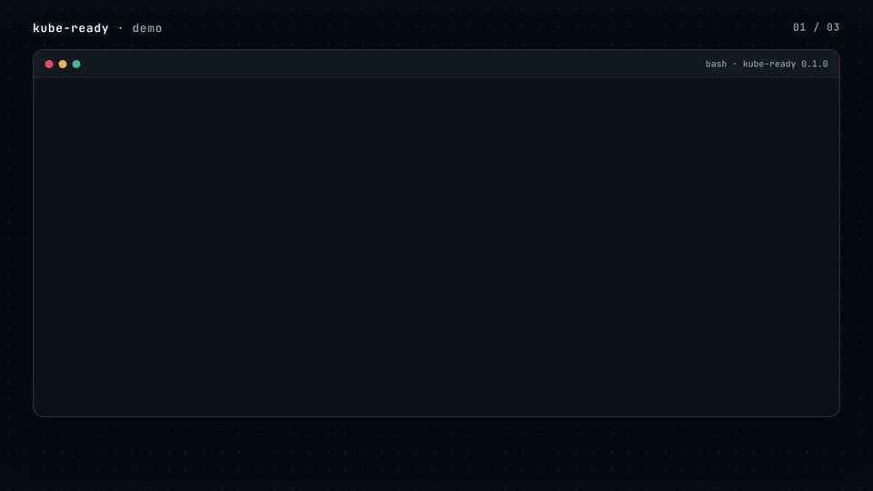
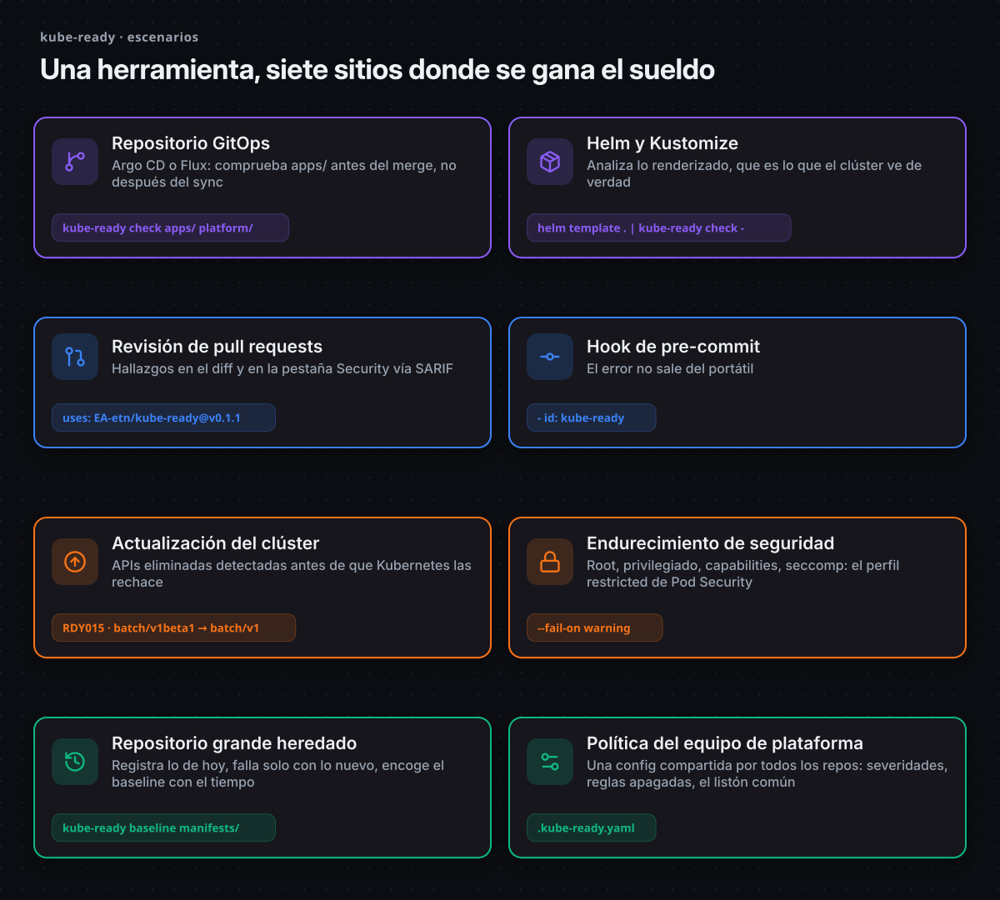

<div align="center">

# kube-ready

**¿Este manifiesto de Kubernetes está listo para producción?**

[](https://github.com/EA-etn/kube-ready/actions/workflows/ci.yml)


[English](README.md) · **Español**

</div>

Un linter pequeño, rápido y con criterio para manifiestos de Kubernetes. Lee YAML plano, la salida
de Kustomize o de `helm template`, y te dice qué va a doler el día que algo falle: imágenes
`latest`, sin límites de recursos, sin probes, una sola réplica, contenedores como root, Secrets
subidos a Git, versiones de API que ya no existen.

No necesita clúster. Tarda un segundo. Rompe el CI con un mensaje claro y una pista para arreglarlo.



<sub>🎬 Vídeo explicativo de dos minutos, con voz: [Español](docs/video/kube-ready-explainer-es.mp4) · [English](docs/video/kube-ready-explainer-en.mp4)</sub>

```
$ kube-ready check examples/bad --verbose

examples/bad/deployment.yaml
  ✖ RDY001  Deployment/api (line 2)  container "api" uses image "myregistry/api:latest" with tag latest
       ↳ Pin a version (`app:1.4.2`) or a digest (`app@sha256:…`).
  ▲ RDY002  Deployment/api (line 2)  container "api" has no cpu or memory request
       ↳ Set `resources.requests.cpu` and `resources.requests.memory`.
  ▲ RDY006  Deployment/api (line 2)  runs 1 replica
       ↳ Set `spec.replicas: 2` or more, or add an HPA with `minReplicas: 2`.
  ✖ RDY009  Deployment/api (line 2)  container "api" is privileged
       ↳ Drop `privileged: true`; add specific capabilities instead.
  ✖ RDY013  Deployment/api (line 2)  volume "data" is a hostPath (/var/lib/api)
       ↳ Use a PersistentVolumeClaim, or a DaemonSet if it is a node agent.
  ▲ RDY014  Secret/api-credentials (line 29)  contains secret data
       ↳ Use Sealed Secrets, External Secrets, SOPS or the cloud provider's secret manager.
  ✖ RDY015  CronJob/nightly-report (line 37)  uses removed apiVersion batch/v1beta1
       ↳ Migrate to `batch/v1`.
  …

6 errors, 15 warnings, 13 info across 5 resources in 1 files.
```

## Cómo funciona



<sub><a href="https://raw.githubusercontent.com/EA-etn/kube-ready/main/docs/diagrams/es/01-how-it-works.png">🔍 Ver a tamaño completo</a></sub>

## ¿Otro linter más?

[kube-score](https://github.com/zegl/kube-score), [kube-linter](https://github.com/stackrox/kube-linter)
y [Polaris](https://github.com/FairwindsOps/polaris) son estupendos y más completos. kube-ready es
el que te lees en una tarde: unas mil líneas de Python, una función por regla, un test por regla, y
cada regla explica *por qué* existe. Está pensado para adoptarlo en cinco minutos y extenderlo en diez.

## Pruébalo en el navegador

**[ea-etn.github.io/kube-ready](https://ea-etn.github.io/kube-ready/)**: pega un manifiesto y mira el veredicto. La página
ejecuta el paquete real en tu navegador con Pyodide, así que no se sube nada a ningún sitio.

## Instalación

```bash
pipx install kube-ready            # o: pip install kube-ready
kube-ready --version
```

O sin instalar nada:

```bash
docker run --rm -v "$PWD:/work:ro" ghcr.io/ea-etn/kube-ready check manifests/
```

## Uso

```bash
kube-ready check manifests/                          # ficheros o carpetas, recursivo
kube-ready check deploy.yaml svc.yaml                # varios ficheros
helm template mi-chart | kube-ready check -          # stdin
kustomize build overlays/prod | kube-ready check -

kube-ready check manifests/ --verbose                # cómo arreglar cada hallazgo
kube-ready check manifests/ --fail-on warning        # CI más estricto
kube-ready check manifests/ --format json            # para scripts
kube-ready check manifests/ --format sarif -o report.sarif   # para code scanning de GitHub
kube-ready check manifests/ --format github                  # anotaciones en el diff del PR
kube-ready rules                                     # la lista completa, con el porqué
```

Códigos de salida: `0` listo, `1` hallazgos iguales o peores que `--fail-on` (por defecto `error`),
`2` error de uso o de configuración.

## Reglas

| Regla | Severidad | Comprueba que… |
|---|---|---|
| RDY001 | error | las imágenes llevan tag inmutable o digest, no `latest` ni sin tag |
| RDY002 | warning | todos los contenedores tienen **requests** de CPU y memoria |
| RDY003 | warning | todos los contenedores tienen **límite** de memoria (el de CPU no se exige a propósito) |
| RDY004 | warning | los contenedores tienen `livenessProbe` (no en Jobs/CronJobs) |
| RDY005 | warning | los contenedores tienen `readinessProbe` (no en Jobs/CronJobs) |
| RDY006 | warning | Deployments/StatefulSets tienen ≥ 2 réplicas, o un HPA con `minReplicas ≥ 2` |
| RDY007 | info | las cargas con varias réplicas tienen un PodDisruptionBudget que las selecciona |
| RDY008 | info | las cargas con varias réplicas se reparten entre nodos (topologySpreadConstraints o podAntiAffinity) |
| RDY009 | error | no hay contenedores `privileged` ni `hostNetwork` / `hostPID` / `hostIPC` |
| RDY010 | warning | está puesto `allowPrivilegeEscalation: false` |
| RDY011 | warning | `runAsNonRoot: true` o un `runAsUser` distinto de 0 (a nivel de pod o contenedor) |
| RDY012 | info | `readOnlyRootFilesystem: true` |
| RDY013 | error | no hay volúmenes `hostPath` |
| RDY014 | warning | no hay `Secret` con `data` / `stringData` en Git |
| RDY015 | error | no se usan versiones de API eliminadas (`extensions/v1beta1`, `batch/v1beta1`, …) |
| RDY016 | info | las cargas llevan la etiqueta `app.kubernetes.io/name` |
| RDY017 | info | los recursos con namespace lo declaran en `metadata.namespace` (desactívala en charts de Helm) |
| RDY018 | warning | los CronJobs tienen `concurrencyPolicy` `Forbid` o `Replace` |
| RDY019 | warning | los Ingress tienen sección `tls` |
| RDY020 | warning | los Services seleccionan al menos un pod de su namespace en la ejecución |
| RDY021 | info | los contenedores sueltan todas las capabilities (`capabilities.drop: [ALL]`) |
| RDY022 | info | hay perfil seccomp (`RuntimeDefault`), a nivel de pod o contenedor |

Las reglas que cruzan recursos (RDY006, RDY007, RDY020) miran todos los manifiestos de la misma ejecución:
pasa la carpeta entera, no un fichero suelto, para evitar falsos positivos.

## Configuración

`.kube-ready.yaml` en el directorio de trabajo, o `--config FICHERO`:

```yaml
disable:
  - RDY017        # Helm / Argo CD ponen el namespace al desplegar
severity:
  RDY014: error   # un Secret en Git nunca es aceptable aquí
fail-on: warning
```

Para saltar reglas en un recurso concreto, una anotación (`"*"` las salta todas):

```yaml
metadata:
  annotations:
    kube-ready/ignore: "RDY006, RDY007"   # una réplica es suficiente para esta herramienta interna
```

## Dónde encaja



<sub><a href="https://raw.githubusercontent.com/EA-etn/kube-ready/main/docs/diagrams/es/02-scenarios.png">🔍 Ver a tamaño completo</a></sub>

## Adoptarlo en un repo grande

¿Cientos de hallazgos el primer día? Regístralos y falla solo con los nuevos:

```bash
kube-ready baseline manifests/            # escribe .kube-ready-baseline.json
git add .kube-ready-baseline.json
kube-ready check manifests/ --baseline .kube-ready-baseline.json --fail-on warning
```

Cada entrada del baseline es la regla, el recurso y el mensaje, no el fichero ni la línea: mover
un manifiesto no lo resucita. Ve arreglando con calma y regenera el baseline cuando quieras
encogerlo. `baseline: .kube-ready-baseline.json` en `.kube-ready.yaml` lo deja por defecto.

## En el CI

### GitHub Actions

```yaml
- uses: EA-etn/kube-ready@v0.1.0
  with:
    path: manifests/
    fail-on: warning
    sarif-file: kube-ready.sarif    # opcional
    # annotations: "false"         # texto plano en vez de anotaciones en el PR

- uses: github/codeql-action/upload-sarif@v3    # los hallazgos salen en la pestaña Security
  if: always()
  with:
    sarif_file: kube-ready.sarif
```

### pre-commit

```yaml
repos:
  - repo: https://github.com/EA-etn/kube-ready
    rev: v0.1.0
    hooks:
      - id: kube-ready
        files: ^manifests/.*\.ya?ml$
```

### Cualquier otro CI

```bash
helm template . | docker run --rm -i ghcr.io/ea-etn/kube-ready check - --fail-on warning
```

## Opiniones incorporadas

- **No se exigen límites de CPU.** Los límites de CPU estrangulan; los de memoria protegen el nodo.
  Lo que necesita el planificador son los requests. Si tu plataforma exige límites de CPU, añade
  una regla (abajo).
- **Dos réplicas es el mínimo.** Con una sola hay caída en cada despliegue. Jobs y DaemonSets
  quedan fuera.
- **Los warnings no rompen el build por defecto.** Adopta la herramienta el primer día con
  `--fail-on error` y sube a `warning` cuando no quede deuda.

## Añadir una regla

Una función en [`src/kube_ready/rules.py`](src/kube_ready/rules.py):

```python
@rule("RDY019", Severity.WARNING, "Image pull policy Always",
      "Pulling on every start slows restarts and depends on the registry being up.")
def pull_policy(res: Resource, ctx: Context) -> Iterator[Finding]:
    for role, c in res.containers():
        if c.get("imagePullPolicy") == "Always":
            yield _finding(res, "RDY019", f'{role} "{c["name"]}" pulls on every start',
                           "Use IfNotPresent with an immutable tag.")
```

Y un test en `tests/test_rules.py`. `ctx.resources` tiene todos los manifiestos de la ejecución,
para reglas que necesiten mirar objetos relacionados.

## Cadena de suministro

El workflow de release aplica a la propia herramienta lo que ella exige a los demás:

- **Actions fijadas por SHA**, con la versión en un comentario; Dependabot las mantiene al día.
- **Imagen firmada sin claves con cosign** (Sigstore, OIDC de GitHub), por digest, más **SBOM y
  atestación de procedencia** de BuildKit. Verifícala antes de ejecutarla:

```bash
cosign verify ghcr.io/ea-etn/kube-ready:0.1.0 \
  --certificate-identity-regexp 'https://github.com/EA-etn/kube-ready/' \
  --certificate-oidc-issuer https://token.actions.githubusercontent.com
```

- **Mínimo privilegio**: los workflows son de solo lectura por defecto y amplían permisos por job.
- **Imagen mínima y sin root**: `python:3.13-slim`, uid 10001, nada más que el paquete.

## Uso desde Python

```python
from kube_ready import api

report = api.check_text(open("deploy.yaml").read())
print(report["summary"], [f["rule"] for f in report["findings"]])
```

## Desarrollo

```bash
pip install -e ".[dev]"
make lint test check      # ruff, mypy --strict, pytest, los ejemplos
```

En [CONTRIBUTING.md](CONTRIBUTING.md) está cómo añadir una regla.

## Hoja de ruta

- [x] 22 reglas, salida SARIF, GitHub Action, hook de pre-commit, imagen multi-arch
- [x] `Service` sin pods que lo respalden, `Ingress` sin TLS, capabilities, seccomp
- [x] Fichero baseline para adoptar poco a poco en repos grandes (`--baseline`)
- [ ] Publicar en PyPI (trusted publishing)
- [ ] Cobertura de Gateway API (`HTTPRoute`) y `NetworkPolicy`

## Licencia

[MIT](LICENSE)
